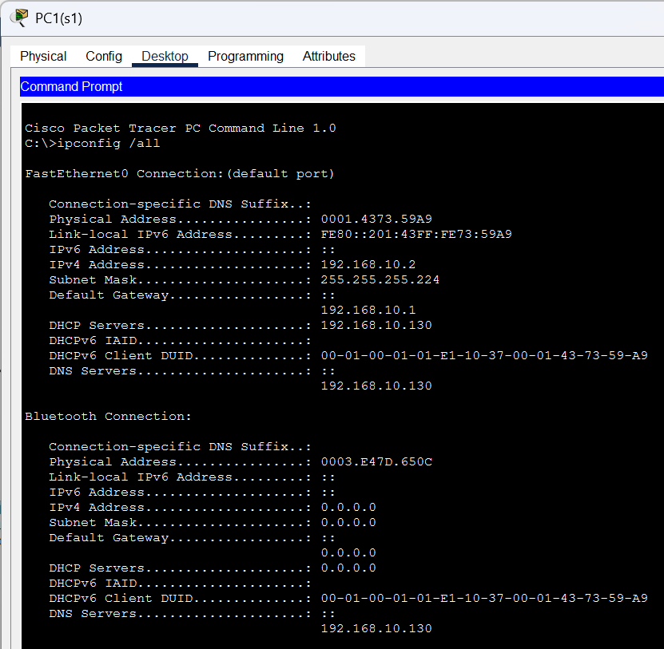
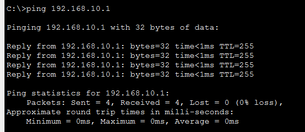
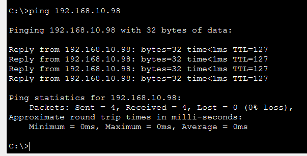
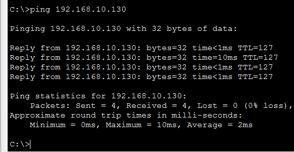
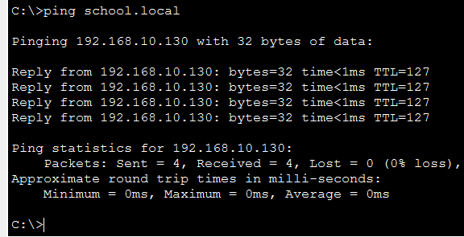

# EN
# simple-school-network

# PL
# prosta-sieć-szkolna

## O projekcie:
Prosta sieć szkoły podstawowej podzielona na 5 podsieci metodą VLMS. Moimi założeniami było zbudowanie 4 podsieci na 4 sale po 21 komputerów (1 komputer nauczyciela i 20 uczniów) z możliwością rozbudowy do maksymalnie 29 urządzeń na salę, ostatnia piąta podsieć została zarezerwowana na serwer DHCP i DNS.

## Topologia:

## Tabela adresacji:

## Tabela VLAN:

## Użyte urządzenia:
Użyłem 8x PC-PT (po 2 na salę), 5x switchy 2960-24TT, 1x Server-PT, 1x Router 2911

## Podjęte decyzje:
Główna sieć 192.168.10.0 zamiast 192.168.0.0, żeby nie dochodziło do konfliktu z domyślnym adresem IP sprzętów domowych.
Użyte maski: /27 dla sal: to najmniejsza podsieć, która mieści 21 komputerów i bramę. Daje 30 adresów hostów, więc zostaje jeszcze zapas na rozbudowę do 29 urządzeń w przyszłości bez marnowania przestrzeni adresowej. /28 dla serwerów: 14 hostów, czyli miejsce na kolejne serwery w przyszłości przy zachowaniu małej podsieci.

## Testy

### 1. Przydzielanie adresów przez DHCP
Komputer automatycznie otrzymał adres IP, maskę, bramę domyślną i adres serwera DNS z puli przypisanej do swojej sali.

### 2. Połączenie z bramą domyślną
Ping z komputera do bramy (subinterfejs routera) potwierdza połączenie PC ↔ switch ↔ router.

### 3. Komunikacja między VLAN-ami
Ping z PC w Sali 1 do PC w Sali 4 potwierdza, że routing między VLAN-ami (router-on-a-stick) działa.

### 4. Dostęp do serwera
Ping do serwera (192.168.10.130) w VLAN 50 potwierdza dostęp do sieci serwerowej z sieci sal.

### 5. Działanie DNS
Ping po nazwie domenowej zamiast adresu IP potwierdza, że serwer DNS poprawnie tłumaczy nazwę na adres.

