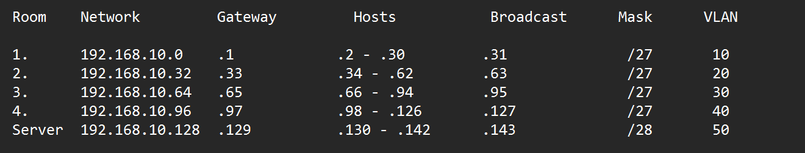
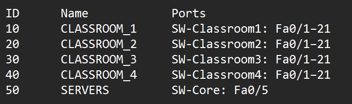

# EN
# simple-school-network

## About the project
A simple elementary school network divided into 5 subnets using VLSM (Variable Length Subnet Mask). The design assumes 4 classrooms with 21 computers each (1 teacher + 20 students), with room to expand up to 29 devices per classroom. The fifth subnet is reserved for the DHCP and DNS server. Cisco Packet Tracer Version: 9.0.1.0858

## Topology

## Addressing table

## VLAN table

## Devices used
- 1x Router 2911
- 5x Switch 2960-24TT (4 classroom switches + 1 core switch)
- 1x Server-PT (DHCP + DNS)
- 8x PC-PT (2 per classroom, for testing)

## Design decisions
- 192.168.10.0 instead of 192.168.0.0: avoids conflicts with the default addresses used by most home routers (e.g. when connecting through a VPN).
- /27 for classrooms: the smallest subnet that fits 21 computers plus the gateway. It provides 30 host addresses, leaving room to grow to 29 devices without wasting address space.
- /28 for servers: 14 host addresses, leaving room for additional servers in the future while keeping the subnet small.

## Tests

### 1. DHCP address assignment
The computer automatically received an IP address, subnet mask, default gateway and DNS server from the pool assigned to its classroom.

### 2. Connectivity to the default gateway
A ping from the PC to its gateway (router subinterface) confirms the PC ↔ switch ↔ router connection.

### 3. Inter-VLAN communication
A ping from a PC in Classroom 1 to a PC in Classroom 4 confirms that inter-VLAN routing (router-on-a-stick) works.

### 4. Server access
A ping to the server (192.168.10.130) in VLAN 50 confirms that the server subnet is reachable from the classroom subnets.

### 5. DNS resolution
A ping using a domain name instead of an IP address confirms that the DNS server correctly resolves names to addresses.

# PL
# prosta-sieć-szkolna

## O projekcie:
Prosta sieć szkoły podstawowej podzielona na 5 podsieci metodą VLMS. Moimi założeniami było zbudowanie 4 podsieci na 4 sale po 21 komputerów (1 komputer nauczyciela i 20 uczniów) z możliwością rozbudowy do maksymalnie 29 urządzeń na salę, ostatnia piąta podsieć została zarezerwowana na serwer DHCP i DNS. Cisco Packet Tracer Version: 9.0.1.0858

## Topologia:

## Tabela adresacji:

## Tabela VLAN:

## Użyte urządzenia:
Użyłem 8x PC-PT (po 2 na salę), 5x switchy 2960-24TT, 1x Server-PT, 1x Router 2911

## Podjęte decyzje:
Główna sieć 192.168.10.0 zamiast 192.168.0.0, żeby nie dochodziło do konfliktu z domyślnym adresem IP sprzętów domowych.
Użyte maski: /27 dla sal: to najmniejsza podsieć, która mieści 21 komputerów i bramę. Daje 30 adresów hostów, więc zostaje jeszcze zapas na rozbudowę do 29 urządzeń w przyszłości bez marnowania przestrzeni adresowej. /28 dla serwerów: 14 hostów, czyli miejsce na kolejne serwery w przyszłości przy zachowaniu małej podsieci.

## Testy

### 1. Przydzielanie adresów przez DHCP
Komputer automatycznie otrzymał adres IP, maskę, bramę domyślną i adres serwera DNS z puli przypisanej do swojej sali.

### 2. Połączenie z bramą domyślną
Ping z komputera do bramy (subinterfejs routera) potwierdza połączenie PC ↔ switch ↔ router.

### 3. Komunikacja między VLAN-ami
Ping z PC w Sali 1 do PC w Sali 4 potwierdza, że routing między VLAN-ami (router-on-a-stick) działa.

### 4. Dostęp do serwera
Ping do serwera (192.168.10.130) w VLAN 50 potwierdza dostęp do sieci serwerowej z sieci sal.

### 5. Działanie DNS
Ping po nazwie domenowej zamiast adresu IP potwierdza, że serwer DNS poprawnie tłumaczy nazwę na adres.

