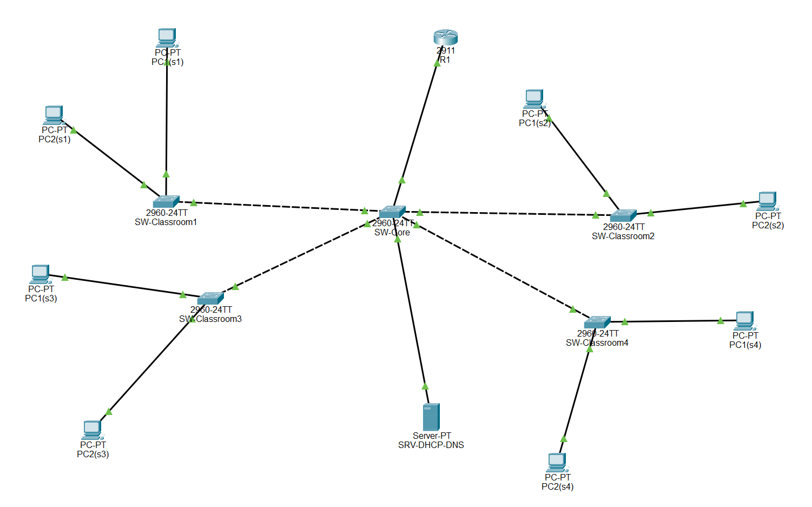
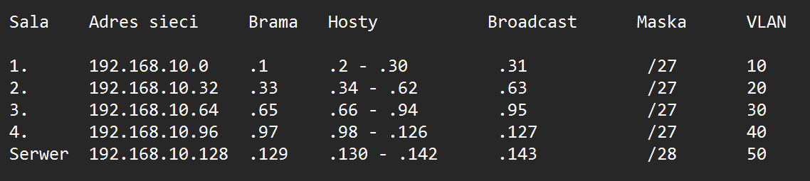
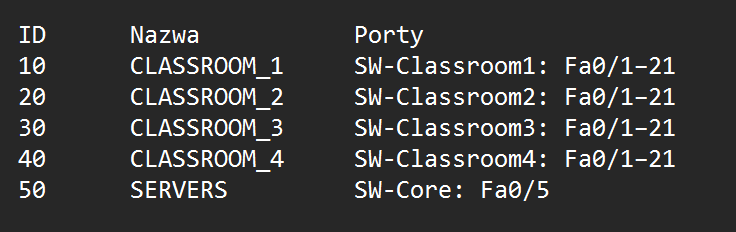

# EN
# simple-school-network

# PL
# prosta-sieć-szkolna

# O projekcie:
Prosta sieć szkoły podstawowej podzielona na 5 podsieci metodą VLMS. Moimi założeniami było zbudowanie 4 podsieci na 4 sale po 21 komputerów (1 komputer nauczyciela i 20 uczniów) z możliwością rozbudowy do maksymalnie 29 urządzeń na salę, ostatnia piąta podsieć została zarezerwowana na serwer DHCP i DNS.

# Topologia:

# Tabela adresacji:

# Tabela VLAN:

# Użyte urządzenia:
Użyłem 8x PC-PT (po 2 na salę), 5x switchy 2960-24TT, 1x Server-PT, 1x Router 2911

# Podjęte decyzje:
Główna sieć 192.168.10.0 zamiast 192.168.0.0, żeby nie dochodziło do konfliktu z domyślnym adresem IP sprzętów domowych.
Użyte maski: /27 dla sal: to najmniejsza podsieć, która mieści 21 komputerów i bramę. Daje 30 adresów hostów, więc zostaje jeszcze zapas na rozbudowę do 29 urządzeń w przyszłości bez marnowania przestrzeni adresowej. /28 dla serwerów: 14 hostów, czyli miejsce na kolejne serwery w przyszłości przy zachowaniu małej podsieci.
